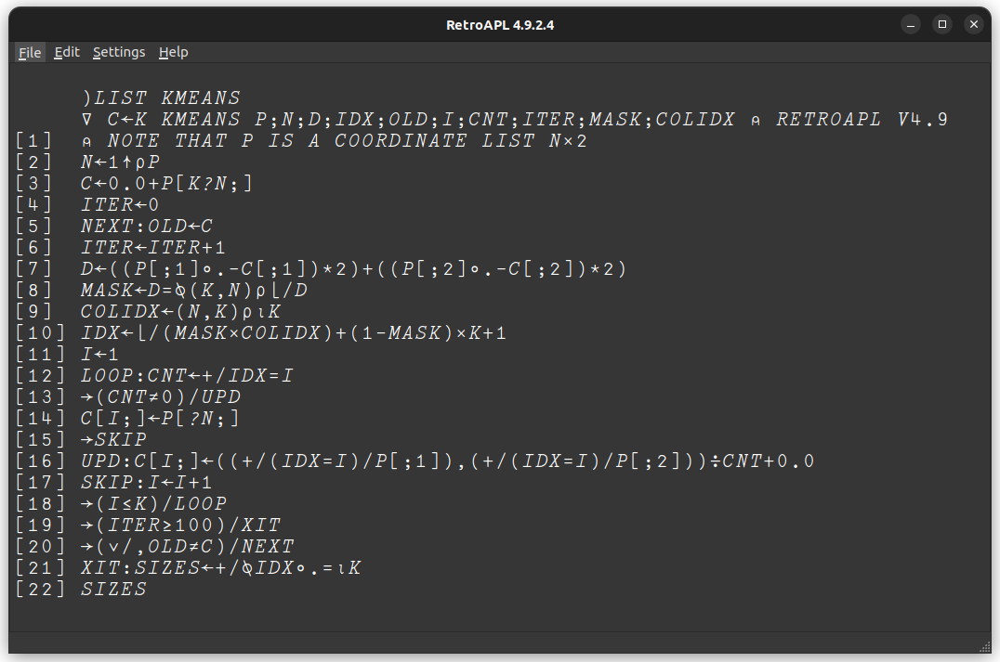

# RetroAPL

RetroAPL is an APL interpreter with the look and feel of the classic
IBM 2741 APL terminal. It has the APL typeball font, and you build
overstruck characters by typing one symbol, backspacing and typing
another on top of it. For the story behind RetroAPL, see
[HISTORY-README.md](HISTORY-README.md).

This codebase began more than 30 years ago as a personal project on DOS
and Windows, with a C interpreter and a Delphi front end. It has since
been ported to 64-bit Linux with a new Qt6 front end, and it builds on
Windows from the same source.



> **There are no prebuilt downloads yet.** You build RetroAPL from
> source. On Linux and Windows a single script does the whole build,
> and a second one installs it; see [Quick start](#quick-start).

## Features

- **Classic APL at a 2741-style terminal.** Two keyboard layouts
  (the original 2741 keymap, and an altered one adjusted for modern
  keyboards), and backspace overstrike composition.
- **Workspaces and function files.** Save and load workspaces, and
  keep functions as separate files.
- **A full-screen function editor**, opened from the File menu or with
  `)EDIT`.
- **Debugging**: `)TRACE`, `)STOP`, `)STEP` and the state indicator
  (`)SI`, `)SIV`).
- **Graphics.** Open any number of graphics windows, draw in them
  (lines, polygons, text, images), read pixels and mouse clicks back
  into APL, and save the result as an image file.
- **Files and programs.** Read and write files from APL, pick one with a
  file dialog, and run other programs.
- **A MIDI sequencer.** It plays up to 16 tracks of loops or one-shot
  sequences in the background while APL keeps working. You send it
  notes and control playback from APL. A program can wait on the music's
  beats and notes as well as on mouse clicks, for example to keep
  graphics in time with the music.
- **MIDI files.** Read Standard MIDI Files into arrays the sequencer can
  play, and write the sequencer's tracks back out.
- **Unicode copy and paste.** Copying APL text produces real Unicode APL
  symbols, and pasting Unicode APL converts back, so code moves easily
  between RetroAPL and documents, email or other APLs.
- **Printing** of the session or a function, to a printer or PDF.
- **Built-in reference.** The Help menu opens browsable references for
  the primitives, every system command and every quad function.
- **`apl_cli`**, a command-line version of the interpreter that reads
  and writes UTF-8, used for the regression tests.

### The language

RetroAPL implements most of classic APL\360, plus a few later additions
such as system ("quad") functions. Some primitives behave differently
from the book, and a few aren't implemented, among them bracket axis
(`⍪`, `⌿` and `⍀` cover the first axis) and domino (`⌹`). Names can't
use APL\360's underscored letters, or `∆` and `⍙`.

`⎕STRUCT` is an experimental container in the style of APL2's nested
arrays, and was inspired by them. Each of its cells holds a value of its
own (text, a vector, a matrix), which can be indexed and assigned into.
Nested arrays themselves aren't supported, so the primitives that go
with them, such as enclose and disclose, aren't implemented. (`⊂` and
`⊃` are bitwise shift functions in RetroAPL.)

The details are in three reference files. They are the same pages the
Help menu shows:

- [Primitive functions](aplhome/resources/primitive_help.md), including
  the [differences from the book](aplhome/resources/primitive_help.md#differences-from-the-book)
  and [what isn't implemented](aplhome/resources/primitive_help.md#not-implemented)
- [System commands](aplhome/resources/system_command_help.md) (`)LOAD`,
  `)SAVE`, `)EDIT`, ...)
- [Quad functions](aplhome/resources/quad_function_help.md): system,
  file, graphics, sequencer and MIDI file functions

### Learning APL

The reference files above describe RetroAPL, not the language. To learn
APL itself, use Gilman and Rose, *APL: An Interactive Approach*. The
third edition (John Wiley & Sons, 1984) is the easiest edition to find,
and it's the one the reference files call "the book." It covers a little
more than RetroAPL implements, but nearly all of it applies as written.

## Platforms

| Platform          | Status                                  |
|-------------------|-----------------------------------------|
| Linux aarch64     | Main development platform (Ubuntu 22.04) |
| Windows 10        | Builds and runs                         |
| Linux x86-64      | Untested                                |
| macOS             | Untested; help from a Mac owner welcome |

## Quick start

### Linux (Ubuntu 22.04 or later)

```bash
sudo apt install git build-essential cmake qt6-base-dev qt6-base-dev-tools libxkbcommon-dev
git clone https://github.com/syncopator-arch/RetroAPL.git
cd RetroAPL
./build.sh            # builds everything
./setup-aplhome.sh    # installs it in ~/aplhome and your applications menu
```

Then start **RetroAPL** from your applications menu.

### Windows

1. Install Qt 6 with the
   [Qt online installer](https://www.qt.io/download-qt-installer)
   (it asks you to sign in with a free Qt account). Choose a custom
   installation, and in the component list select:
   - under a Qt 6 version, **MinGW 64-bit**;
   - under **Build Tools** (called *Developer and Designer Tools* in
     older installers), the **MinGW** compiler of the same version, and
     **CMake**.

   Keep the default install folder, `C:\Qt`. The build scripts look for
   Qt and MinGW there.
2. Get the source. Either install [Git for Windows](https://git-scm.com/download/win)
   and run `git clone https://github.com/syncopator-arch/RetroAPL.git`,
   or on the GitHub page click **Code → Download ZIP** and unzip it.
3. In a Command Prompt, in the RetroAPL folder:

   ```bat
   build.bat
   setup-aplhome.bat
   ```

Then start **RetroAPL** from the Start menu.

## Building

The source is in three parts, which are built in this order:

| Folder       | What it is                                  | Builds                          |
|--------------|---------------------------------------------|---------------------------------|
| `sequencer/` | The MIDI sequencer library (C)              | `libseq.a`                      |
| `backend/`   | The interpreter (C)                         | `libapl.a`, and `apl_cli`       |
| `frontend/`  | The Qt6 GUI (C++), linked with both libraries | `retroapl`                    |

`build.sh` (Linux) and `build.bat` (Windows), in the repository root,
build all three in order. Both take the same commands:

| Command        | What it does                                                   |
|----------------|----------------------------------------------------------------|
| *(none)*       | Build everything.                                              |
| `clean`        | Remove all build output, from all three parts.                 |
| `check`        | Build the libraries and run their regression tests ([Tests](#tests)). |
| `run`          | Linux only: run the program just built.                        |

**After updating the source** (`git pull`), run `clean` and then build
again. The backend makefile doesn't yet track header files, so without
a clean build, old object files can get linked against the new code.

### Linux details

The program is built as `frontend/build/retroapl`. `build.sh` is a
short wrapper around `frontend/build.sh`, so either one works.

To build by hand instead:

```bash
make -C sequencer libseq.a
make -C backend                 # libapl.a and apl_cli
cmake -S frontend -B frontend/build
cmake --build frontend/build
```

`make libapl.a` in the backend builds the interpreter library alone,
not the sequencer library, which the front end also needs. A plain
`make` builds both.

### Windows details

The build uses the MinGW compiler and CMake that come with Qt. The
scripts find them under `C:\Qt` by themselves, and add them to `PATH`
for the length of the build only. With Qt somewhere else, or with more
than one Qt 6 version installed (the last one in name order is used,
so 6.9 is picked over 6.10), set these before running `build.bat`:

```bat
set QT_PREFIX=C:\Qt\6.11.1\mingw_64
set MINGW_ROOT=C:\Qt\Tools\mingw1310_64
set CMAKE_BIN=C:\Qt\Tools\CMake_64\bin
```

`build.bat` runs two scripts in `frontend\`:

- `winbuild.bat` builds the three parts. The program is
  `frontend\build\retroapl.exe`.
- `windeploy.bat` gathers the program, the Qt and MinGW DLLs and Qt's
  plugins in `frontend\deploy\`. Then it checks that every DLL they
  need is either there or part of Windows, and names any that is
  missing.

Both start by calling `winenv.bat`, also in `frontend\`. It finds the
Qt kit, the MinGW compiler and CMake (or uses the settings above),
puts them on `PATH`, and prints which ones it chose. It stops with a
message naming what's missing if it can't find one. It isn't meant to
be run on its own.

`setup-aplhome.bat` copies `frontend\deploy\` into `%APLHOME%\bin`.

## Setting up `$APLHOME`

RetroAPL keeps everything in one folder, named by the `APLHOME`
environment variable: the program itself (in `bin`), the font, the help
pages, and your workspaces, functions, images and MIDI files. A setup
script creates the folder from this repository:

| Platform | Script               | Default folder |
|----------|----------------------|----------------|
| Linux    | `./setup-aplhome.sh` | `~/aplhome`    |
| Windows  | `setup-aplhome.bat`  | `C:\aplhome`   |

Either script takes a different folder as an argument. Each copies in
the program, if it has been built, and adds RetroAPL to your
applications menu (Linux) or Start menu (Windows).

- **On Windows**, the script also sets `APLHOME` for your account if it
  isn't set yet.
- **On Linux**, the menu entry sets `APLHOME` itself. To run RetroAPL
  from a terminal as well, add the `export APLHOME=...` line the script
  prints to your `~/.bashrc`.

Run the script again after each rebuild. It's safe to run again: it
updates the program, font and help pages, but never replaces your own
workspaces, functions, images or MIDI files.

What goes where:

| Path               | What it is                                                    |
|--------------------|---------------------------------------------------------------|
| `bin/`             | The program (and on Windows, its DLLs).                       |
| `fonts/kapl.ttf`   | The APL font. **Required**; this is the only place it's loaded from. |
| `resources/*.md`   | The reference pages shown by the Help menu.                   |
| `ws/`              | Workspaces (`name.ws`). `mpl.ws` loads at startup.            |
| `fns/`             | Function files (`name.fn`).                                   |
| `images/`          | Images; the default folder for the graphics image functions.  |
| `midi/`            | MIDI files; the default folder for the MIDI file functions.   |
| `settings.ini`     | Your settings. Created automatically; don't copy someone else's. |
| `crash.log`        | Written if the interpreter hits a fatal internal error.       |

## Typing APL


*Photo: [Oscar.nierstrasz](https://commons.wikimedia.org/wiki/File:IBM_2741_Communications_Terminal.jpg), [CC BY-SA 4.0](https://creativecommons.org/licenses/by-sa/4.0/)*

APL symbols are typed with the 2741 keyboard layout. Choose between the
original and altered layouts under **Settings**. Composite symbols are
made the way they were on the 2741: type one symbol, press
**Backspace** once (the cursor moves back), then type the second symbol
over it. For example, `○` then Backspace then `|` gives `⌽`.

## MIDI

The sequencer plays through a MIDI output port. Choose the port under
**Settings**; `⎕SEQOPEN ''` then opens it. `⎕SEQPORTS` lists the ports
from APL. The [quad function reference](aplhome/resources/quad_function_help.md)
has a section each on the sequencer and on MIDI files.

- **Windows:** any MIDI output device works, including the built-in
  *Microsoft GS Wavetable Synth*, which needs no extra hardware.
- **Linux:** RetroAPL uses ALSA raw MIDI (`/dev/snd/midi*`), so a USB
  MIDI interface or a synthesizer with USB MIDI works. Software
  synthesizers that offer only ALSA *sequencer* ports, such as FluidSynth
  or TiMidity, can't be reached directly. If no ports are listed, or
  `⎕SEQOPEN` returns `¯2` (no permission), add yourself to the `audio`
  group, then log out and back in:

  ```bash
  sudo usermod -aG audio $USER
  ```

## FAQ

**Why is there no `)COPY`?**
In RetroAPL, functions are kept as source files of their own in
`$APLHOME/fns/`, outside any workspace, and `)ENTER` brings one into
whatever workspace you're in. So the usual reason for `)COPY`, taking a
function from another workspace, doesn't come up. Copying variables may
be added some day. But a workspace isn't the best long-term home for
data anyway: keep anything important outside it, in files written with
the file functions (`⎕FWRITE` and the rest), or through other programs
run with `⎕EXEC`.

**Why overstrikes?**
RetroAPL runs on a screen, not a typewriter, so overstriking isn't a
hardware necessity the way it was on the 2741. It stays because it's
the easier way to type APL. Most composite symbols are built from
symbols already on the keyboard, so there are fewer key positions to
memorize, and you never have to pick glyphs with the mouse.

## Troubleshooting

- **The APL characters don't show, or there's a message about the
  font.** RetroAPL loads its font only from `$APLHOME/fonts/kapl.ttf`.
  Run the setup script, and if you start the program from a terminal,
  make sure `APLHOME` is set there.
- **Linux, the front end fails to link with "No rule to make target
  ../sequencer/libseq.a"** (or `libapl.a`). Build with `./build.sh`, or
  build the libraries first as shown in [Linux details](#linux-details).
- **Linux, CMake prints "Could NOT find XKB".** This is harmless: Qt
  looks for the optional `libxkbcommon` development headers, which
  RetroAPL's build doesn't need, and the build carries on. Installing `libxkbcommon-dev`, which is
  in the [Quick start](#linux-ubuntu-2204-or-later) list, makes the
  message go away.
- **Linux, CMake can't find Qt6, or complains about OpenGL.** Install
  the packages in [Quick start](#linux-ubuntu-2204-or-later). If the
  complaint is about OpenGL, also install `libgl1-mesa-dev`.
- **Windows, `build.bat` says it can't find MinGW or Qt.** Install the
  components listed in [Quick start](#windows), or point the scripts
  at your installation (see [Windows details](#windows-details)).
- **Windows, the program says a DLL is missing when it starts.** Run
  `build.bat` again, or just `frontend\windeploy.bat`, and look at the
  missing-DLL check at the end. Copy any DLL it names into
  `frontend\deploy\`, run `setup-aplhome.bat`, and please open an issue
  so the script can be fixed.
- **Strange crashes or link errors after updating the source.** Run a
  clean build (`./build.sh clean` or `build.bat clean`, then build
  again).

## Tests

The interpreter's regression tests run through `apl_cli`, and the
sequencer library has its own. `./build.sh check` (or `build.bat
check`) runs both. They can also be run by hand:

```bash
make -C sequencer check   # the sequencer library's tests
make -C backend check     # the interpreter's tests
make -C backend check_san # the same, under AddressSanitizer + UBSan (Linux)
```

There are no automated tests for the Qt front end yet.

## Repository layout

```
build.sh, build.bat   Build everything (Linux, Windows)
setup-aplhome.*       Create or update an $APLHOME folder
backend/              The interpreter (C): libapl.a and apl_cli
  tests/              Regression tests: .apl inputs and .expected transcripts
sequencer/            The MIDI sequencer library (C): libseq.a
  tests/              Its tests: .seq scripts, MIDI files, and .expected logs
frontend/             The Qt6 front end (C++), and the scripts that build it
aplhome/              Starting contents for $APLHOME (help pages, default workspace)
fonts/                kapl.ttf, the APL font
docs/images/          Images used by this README
```

## Font

RetroAPL uses **KAPL**, an APL font by Adrian Smith, as distributed
with the A+ programming language. See [`fonts/README.md`](fonts/README.md).

## License

RetroAPL is free software, licensed under the
[GNU General Public License v3.0 or later](LICENSE).
The KAPL font has its own terms; see [`fonts/README.md`](fonts/README.md).

Copyright © Keith Doyle.
