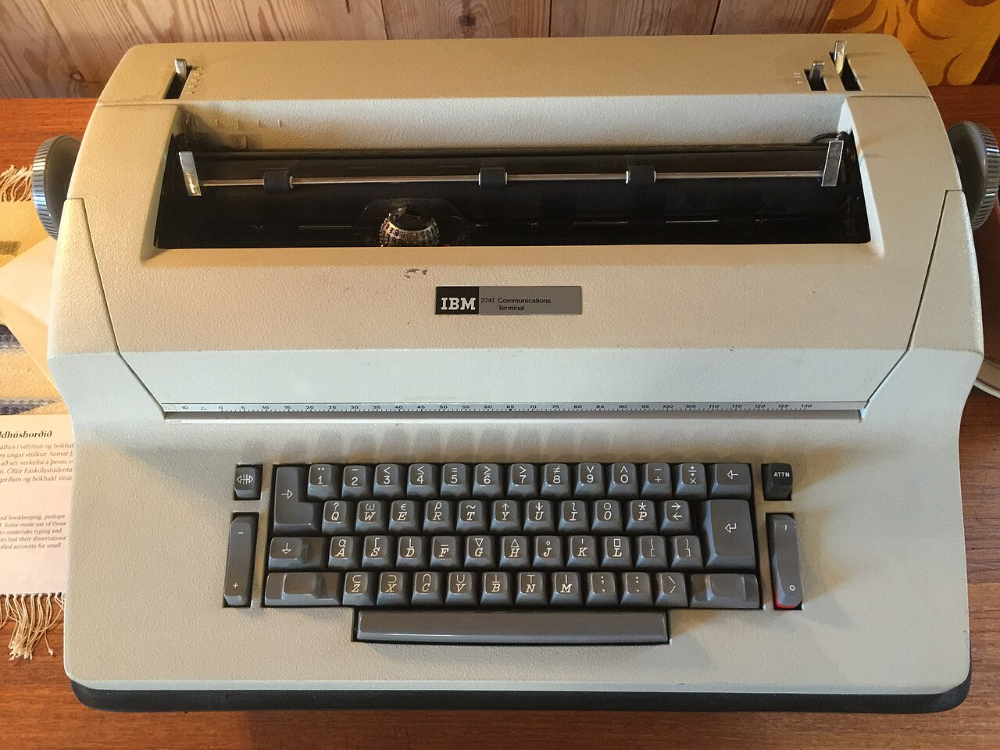

# RetroAPL

RetroAPL is an APL interpreter with the look and feel of the classic
IBM 2741 APL terminal: the APL typeball font, and overstruck characters
built by typing one symbol, backspacing and typing another on top of it.
For more on what makes APL on the 2741 unique and memorable, read 
HISTORY-README.md.

This codebase began more than 30 years ago as a personal project on DOS 
and Windows, with a C interpreter and a Delphi front end. It has since
been ported to 64-bit Linux with a new Qt6 front end, and it builds on
Windows from the same source.

<!-- TODO: screenshot of the terminal and a graphics window -->

## Features

- **Classic APL at a 2741-style terminal.** Two keyboard layouts
  (the original 2741 keymap, and an altered one adjusted for modern
  keyboards) and backspace overstrike composition.
- **Workspaces and function files.** Save and load workspaces, and
  keep functions as separate files.
- **A full-screen function editor**, opened from the File menu or with
  `)EDIT`.
- **Graphics.** Open any number of graphics windows and draw lines,
  polygons, filled shapes, points, text and images in them, and read
  mouse clicks back into APL (`⎕WOPEN`, `⎕PEN`, `⎕POLY`, `⎕FPOLY`,
  `⎕WTEXT`, `⎕WILOAD`, `⎕WCLICK` and more).
- **File I/O** from APL (`⎕FOPEN`, `⎕FREAD`, `⎕FWRITE`, `⎕FDIR`, …),
  and running other programs (`⎕EXEC`, `⎕WEXEC`).
- **Debugging**: `)TRACE`, `)STOP`, `)STEP` and the state indicator
  (`)SI`, `)SIV`).
- **Built-in reference.** The Help menu opens browsable references for
  every system command and quad function.
- **Unicode copy and paste.** Copying APL text produces real Unicode APL
  symbols, and pasting Unicode APL converts back, so code moves easily
  between RetroAPL and documents, email or other APLs.
- **Printing** of the session or a function, to a printer or PDF.
- **Supports most classic APL glyphs and syntax, with only two exceptions,
  domino and bracket dimension syntax-- the latter mitigated by the fact it 
  supports the first dimension variations of dyadic / \ and , (⌿ ⍀ ⍪)
- **`apl_cli`**, a command-line version of the interpreter that reads and
  writes UTF-8, used for the regression tests.

The full list of system commands and quad functions, with what each one
does, is in
[`aplhome/resources/system_command_help.md`](aplhome/resources/system_command_help.md)
and
[`aplhome/resources/quad_function_help.md`](aplhome/resources/quad_function_help.md),
the same files the Help menu shows.

## Platforms

| Platform          | Status                                  |
|-------------------|-----------------------------------------|
| Linux aarch64     | Main development platform               |
| Windows           | Builds and runs                         |
| Linux x86-64      | Untested                                |
| macOS             | Untested; help from a Mac owner welcome |

## Building

### Linux (Ubuntu 22.04 or later)

Install the compiler, CMake and Qt6:

```bash
sudo apt install build-essential cmake qt6-base-dev qt6-base-dev-tools
```

Build everything (the interpreter library, then the Qt front end):

```bash
cd frontend
./build.sh
```

The program is built as `frontend/build/APLTerminal`. `./build.sh clean`
removes all build output, front end and interpreter both.

The interpreter can also be built and tested on its own; see
[Tests](#tests).

### Windows

You need Qt6 for Windows (the Qt online installer puts it in `C:\Qt`).

From a fresh copy of the source, run `frontend\winbuild.bat`. It builds
both the interpreter and the front end. `windeploy.bat` then gathers
the Qt libraries next to the program.

<!-- VERIFY: which compiler (MinGW from the Qt installer, or Visual
     Studio?), and what winenv.bat is for. -->

## Setting up `$APLHOME`

RetroAPL keeps everything in one folder, named by the `APLHOME`
environment variable: the program itself (in `bin`), the font, help
files, workspaces, functions and images. A setup script creates it
from this repository.

On Linux (the default folder is `~/aplhome`), after building:

```bash
./setup-aplhome.sh
```

This also copies the program into `$APLHOME/bin` and adds RetroAPL to
your applications menu. To run it from a terminal too, add the
`export APLHOME=...` line the script shows to your `~/.bashrc`.

On Windows (the default folder is `C:\aplhome`):

```bat
setup-aplhome.bat
```

It also sets `APLHOME` for your account if it isn't set yet.

Either script takes a different folder as an argument, and is safe to
run again after updating or rebuilding: it refreshes the program, font
and help files, but never replaces your own workspaces, functions or
images.

What goes where:

| Path                         | What it is                                                    |
|------------------------------|---------------------------------------------------------------|
| `bin/`                       | The program (and on Windows, the Qt libraries).               |
| `fonts/kapl.ttf`             | The APL font. **Required**; this is the only place it's loaded from. |
| `resources/*.md`             | The reference pages shown by the Help menu.                   |
| `help.dat`                   | Help text used by the interpreter.                            |
| `ws/`                        | Workspaces (`name.ws`). `mpl.ws` loads at startup.            |
| `fns/`                       | Function files (`name.fn`).                                   |
| `images/`                    | Images; the default folder for the graphics image functions.  |
| `settings.ini`               | Your settings. Created automatically; don't copy someone else's. |

## Typing APL



*Photo: [Oscar.nierstrasz](https://commons.wikimedia.org/wiki/File:IBM_2741_Communications_Terminal.jpg), [CC BY-SA 4.0](https://creativecommons.org/licenses/by-sa/4.0/)*

APL symbols are typed with the 2741 keyboard layout; choose between the
original and altered layouts under **Settings**. Composite symbols are
made the way they were on the 2741: type one symbol, press
**Backspace** once (the cursor moves back), then type
the second symbol over it. For example, `○` then Backspace then `|`
gives `⌽`.

<!-- VERIFY: overstrike example, and whether a keyboard chart should
     go here. -->

## Tests

The interpreter's regression tests run through `apl_cli`:

```bash
cd backend
make check        # the tests
make check_san    # the same tests under AddressSanitizer + UBSan
```

There are no automated tests for the Qt front end yet.

## Repository layout

```
backend/     The interpreter (C): builds libapl.a and apl_cli
  tests/     Regression tests: .apl inputs and .expected transcripts
frontend/    The Qt6 front end (C++) and Windows build scripts
fonts/       kapl.ttf, the APL font
aplhome/     Starting contents for $APLHOME (help files, default workspace)
setup-*      Create or update an $APLHOME folder
package-*    Scripts for packaging source and installs
```

## Font

RetroAPL uses **KAPL**, an APL font by Adrian Smith, as distributed
with the A+ programming language. See [`fonts/README.md`](fonts/README.md).

## License

RetroAPL is free software, licensed under the
[GNU General Public License v3.0 or later](LICENSE).
The KAPL font has its own terms; see [`fonts/README.md`](fonts/README.md).

Copyright © Keith Doyle.
